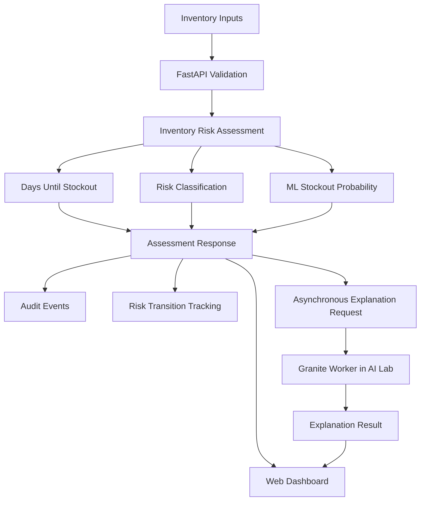

# Mediflow Sentinel
### Predictive Medicine Inventory Risk Intelligence with AI-Powered Explanations

**Mediflow Sentinel** is a medicine inventory risk monitoring prototype that helps healthcare facilities identify potential stockouts, understand replenishment urgency, and make more informed inventory decisions.

It combines rule-based inventory assessment, machine-learning stockout prediction, delivery-delay awareness, an interactive dashboard, auditable assessment events, and asynchronous explanations generated using IBM Granite.

> **IBM Z Datathon 2026 | LinuxONE | Predictive AI + Generative AI**

**Project repository:** https://github.com/Narendra-Joke/mediflow-sentinel/

---

## 1. The Problem

Medicine availability depends on more than the quantity currently recorded in inventory. Daily consumption, safety-stock requirements, incoming supplies, and delivery delays all affect whether a facility can maintain adequate stock.

When inventory risks are identified too late, healthcare teams may have limited time to arrange replenishment or investigate alternative supply options.

Inventory monitoring can also be difficult when risk calculations, recommendations, and historical assessments are scattered across different systems.

Mediflow Sentinel explores a practical approach to these challenges by combining inventory risk calculations, predictive estimates, and human-readable explanations in one prototype.

### The challenges we address

- **Late risk identification:** Inventory may approach stockout before replenishment decisions are made.
- **Delivery uncertainty:** Incoming stock may not arrive before existing inventory is exhausted.
- **Limited decision context:** A risk category is more useful when accompanied by its reasoning and a suggested action.
- **Operational traceability:** Teams need a record of assessments and changes in risk status.
- **Fragmented visibility:** Inventory risk, system status, and recent events should be accessible from one dashboard.

## 2. Our Solution

Mediflow Sentinel accepts inventory information for a facility and medicine, evaluates operational risk, estimates days until stockout, and calculates an experimental machine-learning probability of stockout within seven days.

It classifies risk as `LOW`, `MEDIUM`, `HIGH`, or `CRITICAL` and provides a recommended action. The dashboard presents inventory assessments, risk summaries, system health, audit information, and risk transitions.

An asynchronous AI worker uses **IBM Granite 3.3 2B Instruct** to generate a natural-language explanation of an assessment. This keeps the inventory assessment API separate from the slower language-model inference process.

### Core capabilities

- Inventory risk assessment through a REST API.
- Estimated days until stockout.
- Consideration of daily usage, safety stock, incoming inventory, and delivery delay.
- Seven-day stockout probability from an experimental machine-learning model.
- Risk classification and recommended actions.
- Interactive web dashboard for manual assessments and operational visibility.
- Persistent JSONL audit events for manual assessments.
- Tracking of risk transitions.
- Asynchronous Granite-generated explanations with job-status tracking.
- Health-check endpoint and automated tests.

## 3. How It Works



### Assessment flow

1. A user submits medicine inventory details through the dashboard or REST API.
2. FastAPI validates the request.
3. The application evaluates stock levels, consumption, safety stock, incoming stock, and delivery delay.
4. The system returns a risk category, stockout estimate, prediction probability, and recommended action.
5. Assessment events and risk transitions support traceability.
6. The dashboard displays the result.
7. A separate asynchronous worker processes the explanation request using Granite, and the dashboard retrieves the result through job-status polling.

The machine-learning probability and rule-based risk classification serve different purposes. The probability is an experimental model estimate; the operational risk category and recommendation are produced by the application's assessment logic.

## 4. Predictive AI

The predictive component uses Python, NumPy, Pandas, and scikit-learn.

It generates **5,000 synthetic inventory scenarios** and trains two classification models to estimate whether a stockout may occur within seven days:

- Random Forest Classifier
- Logistic Regression

The feature inputs include inventory stock, daily usage, safety stock, incoming stock, and delivery delay.

### Experimental model results

The following results were measured during development on the generated synthetic dataset.

| Metric | Random Forest | Logistic Regression |
|---|---:|---:|
| Training samples | 3,750 | 3,750 |
| Test samples | 1,250 | 1,250 |
| Accuracy | 96.2% | 91.0% |
| Precision | 94.6% | 87.3% |
| Recall | 97.0% | 93.4% |
| ROC-AUC | 0.995 | 0.975 |
| Batch inference time | 11.877 ms | 0.586 ms |

The Random Forest achieved stronger measured classification performance on this synthetic test set, while Logistic Regression had lower measured inference latency.

These figures are **experimental results, not evidence of performance on real hospital inventory data**. Synthetic data can make evaluation results look more favorable than real-world deployment results. Real inventory records and external validation are required before operational use.

## 5. Generative AI with IBM Granite

Mediflow Sentinel integrates **IBM Granite 3.3 2B Instruct**, using a GGUF model with `llama.cpp` in the AI lab environment.

The purpose of the language model is to turn structured assessment results into a concise explanation that communicates:

- The medicine and facility being assessed.
- Current stock and daily usage.
- Estimated time until stockout.
- Risk classification and experimental probability.
- The recommended action and appropriate limitations.

### Why asynchronous processing?

Language-model inference can take considerably longer than a normal inventory API request. The application therefore uses a job-based workflow:

1. The API creates an explanation job.
2. The worker retrieves and processes the job.
3. The worker writes the generated result.
4. The API exposes job status and the completed explanation.
5. The dashboard polls for the result and displays it when available.

The worker also includes response checks and a structured fallback for invalid or inconsistent generated output.

The inventory assessment remains available independently of the language-model explanation. A delayed explanation should not be interpreted as a failed inventory assessment.

**Model limitation:** The current quantized Granite model runs through CPU-based inference in the AI lab. This project demonstrates deployment on LinuxONE and integration with its AI lab environment; it does not claim that this particular model inference path is accelerated by the IBM Telum processor's AI accelerator.

## 6. IBM Z / LinuxONE

The application was developed and tested in an IBM LinuxONE Community Cloud environment.

### Environment and technologies

- **Platform:** IBM LinuxONE Community Cloud
- **Operating system:** Ubuntu 24.04 on `s390x`
- **API:** Python 3.12 and FastAPI
- **Validation:** Pydantic
- **Predictive AI:** scikit-learn, NumPy, Pandas
- **Generative AI:** IBM Granite 3.3 2B Instruct and `llama.cpp`
- **AI lab runtime:** Docker-hosted JupyterLab environment
- **Interface:** HTML, CSS, and JavaScript dashboard
- **Testing:** pytest
- **Version control:** Git and GitHub

The FastAPI application runs on the LinuxONE host. The Granite inference worker runs separately in the AI lab container and communicates with the application through shared job and result files.

This separation demonstrates how an application service and a resource-intensive AI inference component can operate as distinct processes.

## 7. Technology Stack

| Layer | Technologies |
|---|---|
| API and application logic | Python, FastAPI |
| Request validation | Pydantic |
| Predictive modelling | scikit-learn, NumPy, Pandas |
| Generative AI | IBM Granite 3.3 2B Instruct, llama.cpp |
| AI execution environment | Docker, JupyterLab |
| User interface | HTML, CSS, JavaScript |
| Audit and job persistence | JSONL and file-based job/result records |
| Testing | pytest |
| Platform | IBM LinuxONE Community Cloud, Ubuntu 24.04, s390x |
| Source control | Git, GitHub |

## 8. API Reference

Start the API and open `/docs` to explore the interactive Swagger UI.

| Method | Endpoint | Purpose |
|---|---|---|
| `GET` | `/health` | Check application health |
| `POST` | `/inventory/assess` | Assess medicine inventory risk |
| `GET` | `/events` | Retrieve audit events |
| `GET` | `/events/transitions` | Retrieve risk transition history |
| `GET` | `/dashboard` | Serve the dashboard |
| `POST` | `/genai/explanations` | Submit an explanation job |
| `GET` | `/genai/explanations/{job_id}` | Retrieve explanation job status/result |

### Example: assess inventory

Request:

```json
{
  "facility_id": "HOSP-001",
  "medicine": "Insulin",
  "stock": 30,
  "daily_usage": 12,
  "safety_stock": 20,
  "incoming_stock": 0,
  "delivery_delay_days": 3
}
```

Send the request to:

```text
POST /inventory/assess
Content-Type: application/json
```

The response includes the submitted inventory values, estimated days until stockout, risk classification, recommended action, assessment timestamp, and `predicted_stockout_probability_7_days`.

The exact result depends on the running application and its model output.

### Health check

```bash
curl -sS http://127.0.0.1:8000/health
```

Expected response:

```json
{
  "status": "healthy"
}
```

## 9. Run the Project

### Requirements

- Python 3.12 or compatible version.
- pip.
- Git.
- Access to an IBM LinuxONE environment for reproducing the original deployment.
- The separately configured AI lab and Granite model for live generative explanations.

### Clone the project

```bash
git clone https://github.com/Narendra-Joke/mediflow-sentinel.git
cd mediflow-sentinel
git checkout feature/delivery-aware-risk
```

### Create a virtual environment

```bash
python3 -m venv .venv
source .venv/bin/activate
```

### Install dependencies

```bash
pip install -r requirements.txt
```

### Start the API

```bash
.venv/bin/uvicorn src.api:app --host 0.0.0.0 --port 8000
```

Open these URLs on the machine where the application is accessible:

- API documentation: `http://127.0.0.1:8000/docs`
- Dashboard: `http://127.0.0.1:8000/dashboard`
- Health check: `http://127.0.0.1:8000/health`

When running on a remote LinuxONE instance, use an appropriate SSH tunnel or securely configured network access to view these pages from your browser. Do not expose a development server publicly without appropriate security controls.

### Run automated tests

In another terminal, from the project directory:

```bash
.venv/bin/python -m pytest -q
```

During development, the project test suite completed with **39 passing tests**. Rerun the suite against the final submitted commit to confirm the final result.

### Generative AI worker

Live Granite explanations require the AI lab container, the model file, and the shared job directory to be configured separately. Starting FastAPI alone does not start the Granite worker.

Follow the project's AI lab setup and worker instructions for that environment. The API's explanation endpoints use the job-status workflow to expose pending and completed results.

## 10. Project Structure

```text
mediflow-sentinel/
├── src/
│   ├── api.py                 # FastAPI endpoints and orchestration
│   ├── inventory.py           # Inventory assessment logic
│   ├── predictive.py          # Predictive model and metrics
│   └── simulator.py           # Inventory scenario support
├── scripts/
│   └── genai_worker.py        # Asynchronous Granite worker
├── static/
│   └── dashboard.html        # Interactive dashboard
├── tests/
│   ├── test_api.py
│   └── test_inventory.py
├── requirements.txt
├── .gitignore
└── README.md
```

Runtime audit records and AI job/result files are generated separately and are not intended to be committed as application source data.

## 11. Community Value and Expected Impact

Mediflow Sentinel is designed for healthcare inventory teams, clinics, hospitals, and other organizations that manage essential medicines.

Potential benefits include:

- Earlier visibility into possible stockouts.
- Better awareness of delivery-delay risk.
- More consistent and explainable inventory assessments.
- Clearer replenishment priorities for human review.
- An audit trail for assessment activity and risk changes.
- A foundation for future integration with real inventory systems.

The prototype is intended to support inventory decision-making. It does not prescribe treatment, replace a pharmacist or supply-chain professional, or guarantee medicine availability.

## 12. Limitations and Responsible Use

- The machine-learning models were trained on synthetic data, not validated hospital records.
- Reported metrics describe the synthetic test set only.
- Stockout probabilities are experimental and should not be treated as calibrated real-world forecasts.
- Granite-generated text may be incorrect; generated explanations require verification against the structured assessment.
- The current model inference path is CPU-based and may take significant time to respond.
- The prototype does not automatically purchase, order, dispense, or prescribe medicine.
- Production deployment would require real-world validation, access controls, secure data handling, monitoring, and integration with trusted inventory sources.

## 13. Demo Walkthrough

A short demonstration can follow this sequence:

1. Open the dashboard and show application health and inventory risk summaries.
2. Submit an example medicine inventory assessment.
3. Explain how stock, daily usage, safety stock, and delivery delay affect the result.
4. Show the risk category, estimated days until stockout, and experimental seven-day prediction.
5. Show the audit event and risk-transition view.
6. Show the asynchronous Granite explanation appearing in the dashboard.
7. Close with the LinuxONE deployment, technical architecture, and limitations.

For a three-minute submission video, prioritize the working application and its value. Keep setup commands and implementation details in the README rather than spending most of the video on terminal output.

## 14. Open-Source Resources

- **Project repository:** https://github.com/Narendra-Joke/mediflow-sentinel
- **IBM Granite 3.3 2B Instruct GGUF:** https://huggingface.co/ibm-granite/granite-3.3-2b-instruct-GGUF
- **IBM Z Datathon community:** https://community.ibm.com/zsystems/datathon/
- **AI lab repository:** https://github.com/linuxone-community-cloud/jupyter-lab-ml
- **FastAPI:** https://fastapi.tiangolo.com/
- **scikit-learn:** https://scikit-learn.org/
- **llama.cpp:** https://github.com/ggml-org/llama.cpp

Review the applicable licenses and attribution requirements for the model, libraries, and other resources before redistribution.

## 15. Future Improvements

- Evaluate and calibrate predictions using representative real-world inventory data.
- Add uncertainty reporting and configurable risk thresholds.
- Integrate trusted inventory and supplier-delivery data sources.
- Add authenticated users, role-based permissions, and secure audit access.
- Improve background-worker reliability, observability, and job recovery.
- Evaluate model-serving performance and supported AI acceleration options on the target platform.
- Conduct usability testing with healthcare inventory stakeholders.

## Acknowledgements

Built for the IBM Z Datathon 2026 using IBM LinuxONE Community Cloud and open-source AI and application technologies.

---

**Disclaimer:** Mediflow Sentinel is an experimental prototype for medicine inventory risk awareness. Its predictions and generated explanations are not clinically validated and must not be used as the sole basis for healthcare or procurement decisions.
